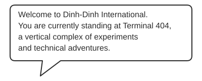
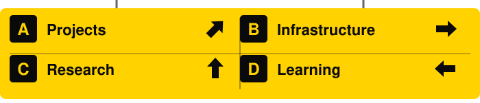

<!-- # ✈️ Dinh-Dinh INTERNATIONAL AIRPORT -->

<!-- ## 01 — Arrival Detected -->

<!-- AIRPORT ASSET: arrivals-terminal.svg -->

<!--  -->

<!-- OFFICER AVATAR: /assets/officer/welcome.svg -->
<!-- 
Welcome to Dinh-Dinh International. Jewel, a vertical complex of projects, experiments, and technical adventures. 

 -->

<table>
<tr>
<td valign="top" align="center">

**OFFICER ON DUTY**

</td>
<td valign="center">

<!-- ### "Welcome, traveler." -->

<!-- Your arrival has been registered. The local time at your point of origin is **{{local_time}}**. -->

</td>

</tr>
</table>

---

<!-- ## Destination Briefing -->

<!-- AIRPORT ASSET: directory-board.svg -->

<table>
<tr>
<td valign="top" align="center">

**INFORMATION DESK**

</td>
<td valign="top">

### What is this place, you may ask?

Terminal 404 contains a selection of Dinh-Dinh's technical projects, infra experiments, and investigations into the inner workings of computers. Some exhibits are complete, others are under construction. 

If you find something interesting, consider it an authorized detour.

| Floor | Exhibits |
|---|---|
| **L4 — Museum** | The start of my programming journey |
| **L3 — Brewery** | Experimental projects |
| **L2 — Marketplace** | Things I built for fun |
| **L1 — Arrival** | Where you are now lol |
| **B1 — Infra** | Cloud, DevOps, containers, and self-hosting |
<!-- AIRPORT ASSET: /assets/directory-board.svg -->

<!--  -->

*Please note that some exhibits remain under construction. This is not grounds for a refund.*

</td>
</tr>
</table>

---

<!-- AIRPORT ASSET: departure-gate.svg -->

<table>
<tr>
<td valign="top" align="center">

**OFFICER ON DUTY**

</td>
<td valign="top">

<!-- AIRPORT ASSET: /assets/gate-open.svg -->

### You are free to proceed.

Thank you for choosing Dinh-Dinh International.

We wish you a productive visit and a pleasant browsing experience.

*We kindly remind you that curiosity is not subject to customs duty, and there is no penalty for staying longer than anticipated.*

</td>
</tr>
</table>

---

Dinh-Dinh INTERNATIONAL · DEPARTMENT OF UNNECESSARY FORMALITIES · EST. SOME TIME AGO

⬇️ **PLEASE PROCEED TO THE REST OF THE PROFILE** ⬇️

